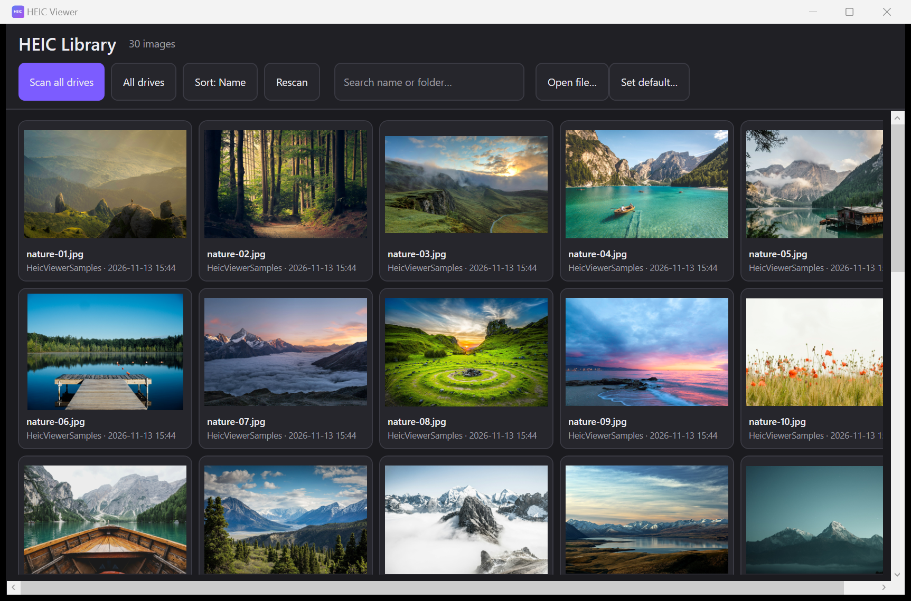
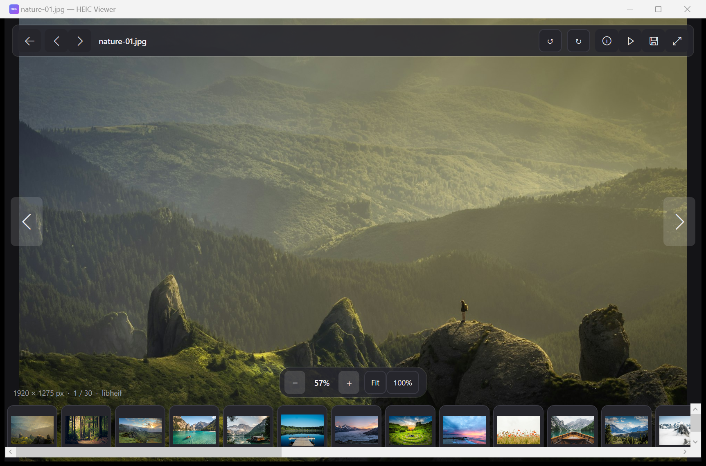

# HEIC Viewer

A fast, modern Windows image viewer built for HEIC — and it opens your whole photo library, not just one file.



## Why

Windows Photos refuses many HEIC files unless you pay for the HEVC codec. HEIC Viewer bundles its own decoder (libheif + libde265 via Magick.NET), so it opens every HEIC/HEIF/HIF/AVIF profile — including 10-bit HEIX iPhone/MIAF files — free, offline, no codecs required.



## Features

- 🖼 **Library** — scans all fixed drives for HEIC-family images, virtualized thumbnail grid, on-disk thumbnail cache (second scan is instant)
- 🔍 **Zoom & pan** — wheel zooms at the cursor, drag to pan, double-click toggles fit / 100%
- 🧭 **Browse** — ◀ ▶ across folders or the whole library, thumbnail strip, Home / End
- ℹ **EXIF info panel** — camera, date taken, exposure, ISO, aperture, focal length
- ▶ **Slideshow** (Space) with fade transitions
- 💾 **Save as JPG / PNG** — one-click conversion
- ↻ Rotate, fullscreen (F11), drag & drop, single instance
- 🌙 Dark Fluent-style UI; floating chrome that goes immersive in fullscreen

## Download

Grab the single portable exe (~75 MB) from [Releases](../../releases). Copy it anywhere and run — **nothing to install** (Windows 10 / 11, 64-bit).

The first launch unpacks its decoder once (a few seconds); after that it opens instantly.

## Make it the default for .heic files

1. Right-click any `.heic` file → **Open with → Choose another app → HEIC Viewer** → tick **"Always"**, or
2. Run `HeicViewer.exe --register`, then open Settings → Default apps → HEIC Viewer.

## Keyboard

| Key | Action |
|---|---|
| ← / → | Previous / next image |
| Mouse wheel / + − | Zoom at cursor |
| Drag | Pan |
| F / 1 | Fit to window / 100% |
| R / L | Rotate right / left |
| I | Info panel |
| Space | Slideshow |
| Esc | Back to library |
| F11 | Fullscreen |
| Home / End | First / last image |
| Ctrl+O | Open file |

## Build from source

Requires the .NET 8 SDK (WPF workload):

```powershell
dotnet publish src/HeicViewer -c Release -r win-x64 --self-contained true `
  -p:PublishSingleFile=true -p:IncludeNativeLibrariesForSelfExtract=true `
  -p:EnableCompressionInSingleFile=true
# output: src/HeicViewer/bin/Release/net8.0-windows/win-x64/publish/HeicViewer.exe
```

## How it works

`DecodeService` decodes through Magick.NET's bundled libheif/libde265 and falls back to Windows Imaging Component when the (optional) HEIF/HEVC codecs are installed. Thumbnails are rendered once per file into `%LOCALAPPDATA%\HeicViewer\thumbs`, keyed by path + size + mtime, by 2–4 background workers.

## Sample images

`docs/samples` ships 30 royalty-free nature photos (used for the screenshots above and handy for testing the app — open the folder and browse). A selection:

| | | |
|---|---|---|
|  |  |  |
|  |  |  |

Photos are from [Unsplash](https://unsplash.com) contributors, used under the [Unsplash License](https://unsplash.com/license) (free for any use). Source URLs: [docs/samples/SOURCES.txt](docs/samples/SOURCES.txt).

## License

MIT — see [LICENSE](LICENSE).

<div dir="rtl">

## فارسی

نمایشگر سریع و مدرن HEIC برای ویندوز: کتابخانه‌ی تصاویر روی همه‌ی درایوها، زوم و پان، پنل مشخصات EXIF، اسلایدشو و تبدیل به JPG — با دیکدر داخلی، بدون نیاز به کدک پولی ویندوز.

فایل پرتابل را از بخش Releases دانلود کنید و اجرا کنید؛ نیازی به نصب نیست.

</div>
